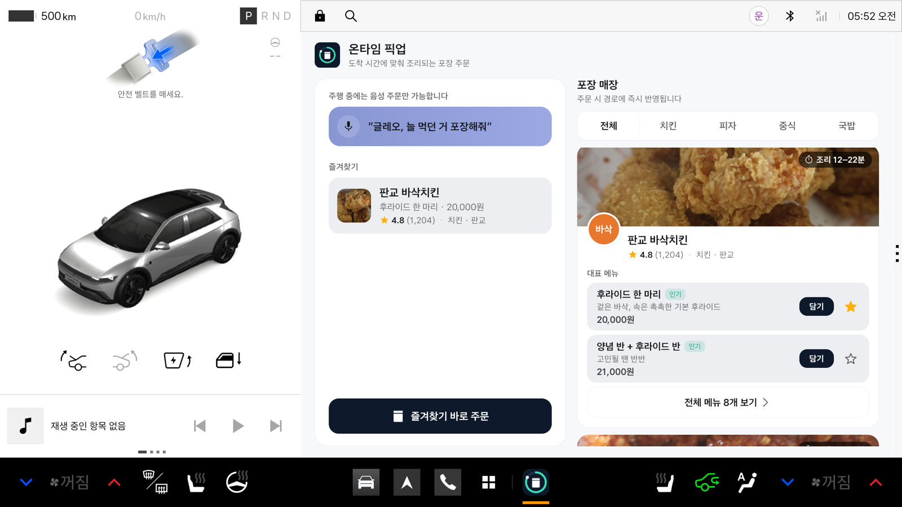
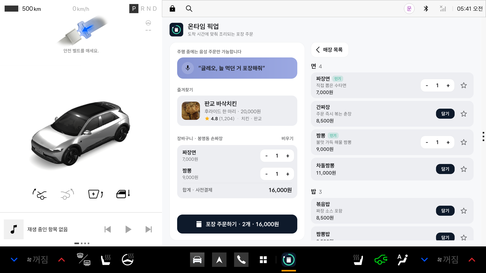
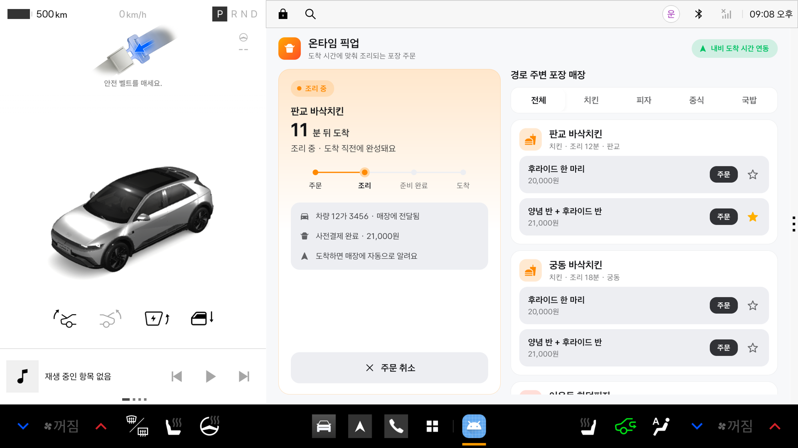
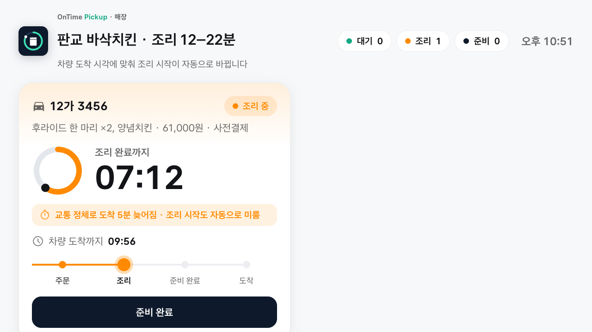
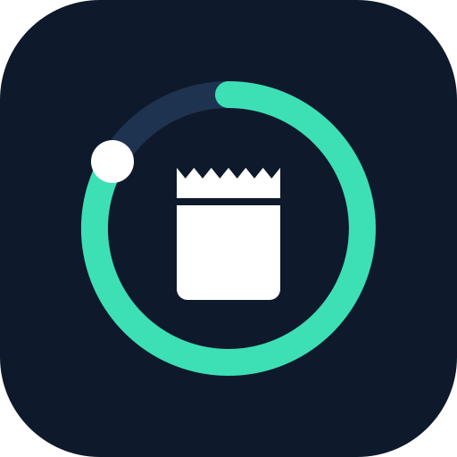

<p align="center">
  <picture>
    <source media="(prefers-color-scheme: dark)" srcset="assets/brand/wordmark-dark.svg">
    
  </picture>
</p>

# 온타임 픽업 (OnTime Pickup)

**운전 중 음성 한 마디로 포장 주문을 넣으면, 내비게이션 도착 예정 시간에 맞춰 매장이 조리를 시작해 도착하는 순간 차 앞에서 받아 가는 차량용 픽업 앱.**

현대자동차그룹 차량용 앱 개발 공모전(Pleos Playground) 출품작 · 대학생 부문 · 개인 참가(박상원)

- APK: [`apk/박상원_OnTimePickup_release.apk`](apk/)
- 시연 영상: [`demo/OnTimePickup_demo.mp4`](demo/OnTimePickup_demo.mp4) (1분 34초, 한국어 내레이션: 문제 상황 → Pleos Connect 에뮬레이터에서 매장 선택·메뉴판·장바구니·실제 주문 → 매장 대시보드 → 정체 시나리오 30배속 → 차 앞 픽업)

| 매장 목록 (주차 중) | 매장 메뉴판 + 장바구니 |
|---|---|
|  |  |
| **주문 진행 (Pleos Connect Emulator, 실제 내비 ETA)** | **같은 주문의 매장 대시보드** |
|  |  |

에뮬레이터에서 주문하면 NaviHelper가 실제로 매장까지 경로를 잡고, 내비가 준 남은 시간(위 화면은 10분 남음)으로 조리 시작 시각이 정해진다. 왼쪽 링은 로고와 같은 모양으로, 매장까지 남은 시간만큼 줄어든다. 매장 대시보드에는 같은 주문이 차량 번호, 메뉴(같은 메뉴는 ×2로 묶음), 사전결제 금액과 함께 뜨고, 도착 예정이 늦어지면 조리 시작도 자동으로 미뤄진다. 정체 시나리오 전체 흐름은 시연 영상의 30배속 구간에서 볼 수 있다.

## 어떻게 동작하나
1. 주차 중에는 매장 목록에서 매장을 골라 메뉴판(세트·면·밥·사이드 등 그룹별 개별 메뉴)에서 장바구니에 담고 수량을 정해 주문합니다. 경로 위에 있는 매장이 아니어도 됩니다.
2. 메뉴 옆 ☆로 즐겨찾기를 저장해 두면, 주행 중에는 화면 대신 Gleo 음성 "늘 먹던 거 포장해줘" 한 마디로 그 메뉴가 주문됩니다.
3. 앱이 매장을 경로의 첫 경유지로 넣고(`addWaypoint`), 안내 중이 아니면 목적지로 설정합니다(`requestRoute`).
4. 15초마다 NaviHelper에서 남은 시간(`remainTime`)을 받아 서버로 보냅니다. 서버는 `조리 시작 = 도착 예정 − 조리시간 − 1분`을 계속 다시 계산합니다. 정체로 늦어지면 조리 시작도 자동으로 늦춰집니다.
5. 경유지 도착 이벤트(`onWayPointArrived`)가 오면 매장 화면에 차량 번호와 함께 도착 알림이 뜹니다.

## 구성
| 경로 | 내용 |
|---|---|
| `android/` | Pleos Connect 앱 (Kotlin, minSdk 28, targetSdk 34) |
| `server/` | 주문 서버(FastAPI) + 매장 대시보드(`/dashboard/{storeId}`) + 시연용 주행 시뮬레이터 |
| `apk/` | release APK |
| `demo/` | 시연 영상 |

사용한 Pleos Connect SDK·기능
- **NaviHelper SDK 3.0.5**: `getRouteStateInfo`, `addWaypoint`, `requestRoute`, `getWaypointInfo`/`getDestinationInfo`(remainTime), `onWayPointArrived`/`onDestinationArrived`
- **Gleo Interface**: `android/app/src/main/assets/schema.json`에 `ORDER_USUAL`("늘 먹던 거" = 즐겨찾기 주문), `FIND_PICKUP_STORE`(경로 주변 매장), `CANCEL_PICKUP_ORDER`(주문 취소) 3개 function
- 주행 규제: 주문 화면은 Distraction Optimization 미선언(주차 중에만 열림). 주행 중엔 음성 + 포그라운드 서비스로만 동작
- 결제: Pleos Payment SDK 공개 전까지 사전결제 목업

## 디자인
Pleos Connect UI Design Guide를 따랐다. 토큰은 `android/.../Pleos.kt` 한 곳에 모았다.
- 색: System Color 토큰 (다크 `#131417`/`#1D1E21`/`#313236`, 상태색 active `#00E074` · positive `#0082FF` · negative `#FF4C28`), 라이트·다크 모두 지원
- 글자: Asta Sans, 가이드 위계 그대로 (Headline 60 · Title 36/32 · Body 30/28/26 · Label 24/20)
- 컴포넌트: Page Navigation, Basic Button Large(높이 100), Tabs(Box), Toast(최대 너비 792), 누르면 97%로 살짝 가라앉고 배경 한 단계 진하게
- 한눈에 읽히게: 왼쪽은 지금 주문(남은 분 · 단계) 또는 즐겨찾기·장바구니, 오른쪽은 매장 목록과 메뉴판. 문장은 3줄 이하
- 매장 카드: 음식 사진 위에 조리 시간 범위(예: 조리 12–22분), 사진 경계에 걸친 매장 로고, 별점·리뷰 수. 카드를 누르면 같은 자리에서 메뉴판으로 넘어간다
- 모션: 한 가지 감속 곡선(cubic-bezier 0.2, 0, 0, 1)으로 통일. 매장 카드가 차례로 떠오르며 등장, 스크롤 시 음식 사진 패럴랙스, 목록 ↔ 메뉴판 슬라이드 전환, 메뉴 그룹 칩을 누르면 해당 그룹까지 부드럽게 스크롤, 즐겨찾기 별은 튀어 오르듯 채워짐. 주행 중에는 이 화면이 열리지 않는다
- 매장 대시보드도 같은 토큰과 글꼴을 쓴다

## 시연용 매장
Pleos Connect Emulator의 내비는 자체 기본 위치(성남 수정구)를 쓴다. 그래서 그 근처에 시연용 매장 `s0`(판교 바삭치킨)을 두었다. 나머지 매장은 1차 서비스 지역인 대전 유성구 기준이다.
매장마다 그룹별 개별 메뉴(6~12개)와 조리 시간 범위(12–32분)가 있다. 조리 시작 시각 계산에는 범위의 아래쪽 값(`prepMin`)을 쓴다.

## 테스트 환경
- Android Studio + **Pleos Connect Emulator v2.1.0 (API 34, arm64)**
  - macOS에서는 `-gpu host`로 실행해야 합니다 (swiftshader에서는 drivingview가 종료됨)
  - `emulator -avd <Pleos AVD 이름> -no-snapshot -gpu host`
- 서버: Python 3.11+, `fastapi`, `uvicorn`
- 빌드: JDK 17, Gradle 8

## 실행 방법

### 1) 주문 서버 + 매장 대시보드
```bash
cd server
python3 -m venv .venv && .venv/bin/pip install fastapi uvicorn
.venv/bin/uvicorn app:app --host 0.0.0.0 --port 8080
# 매장 대시보드: http://127.0.0.1:8080/dashboard/s1
```

### 2) 앱 설치 (에뮬레이터)
```bash
adb install -r -g "apk/박상원_OnTimePickup_release.apk"
```
앱은 에뮬레이터에서 호스트 PC의 서버(`http://10.0.2.2:8080`)에 붙습니다. 매장 선택 → 메뉴 → 주문을 누르면 대시보드에 주문이 뜹니다.

> 내비가 20초 안에 남은 시간을 주지 않는 환경에서는 20분 추정치로 주문을 진행하고 화면에 "추정"으로 표시합니다.

### 3) 내비 없이 대시보드 시나리오만 보기
```bash
# 서버를 시간 압축 모드로 띄운 뒤
TIME_SCALE=30 .venv/bin/uvicorn app:app --port 8080
# 다른 터미널에서: 주문 → 정체 +6분 → 일부 해소 → 도착
.venv/bin/python sim_drive.py --store s1 --speed 30
```

### 4) 직접 빌드
```bash
cd android
JAVA_HOME=<JDK 17 경로> ./gradlew assembleRelease
# → android/app/build/outputs/apk/release/app-release.apk
```

## 사용한 오픈소스 리소스
- 글꼴: [Asta Sans](https://github.com/42dot/Asta-Sans) (SIL Open Font License 1.1, 라이선스 전문 `android/app/src/main/assets/fonts/AstaSans-OFL.txt`)
- 아이콘: [Material Symbols](https://github.com/google/material-design-icons) Rounded (Apache License 2.0)
- 매장 음식 사진(`android/app/src/main/res/drawable-nodpi/store_*.jpg`, 720px로 축소): Wikimedia Commons
  - 판교 바삭치킨: [Korean fried chicken 240206](https://commons.wikimedia.org/wiki/File:Korean_fried_chicken_240206.jpg), Startandstar, CC0
  - 궁동 바삭치킨: [Yangnyeom Chicken Korean fried chicken](https://commons.wikimedia.org/wiki/File:Yangnyeom_Chicken_Korean_fried_chicken.jpg), Startandstar, CC0
  - 어은동 화덕피자: [Margherita pizza on plate](https://commons.wikimedia.org/wiki/File:Margherita_pizza_on_plate.jpg), Shisma, [CC BY 4.0](https://creativecommons.org/licenses/by/4.0/)
  - 봉명동 손짜장: [Jajangmyeon (mixed)](https://commons.wikimedia.org/wiki/File:Jajangmyeon_(mixed).jpg), 최광모, CC0
  - 유성 순대국밥: [Korean soup-Sundae gukbap-01](https://commons.wikimedia.org/wiki/File:Korean_soup-Sundae_gukbap-01.jpg), pcamp, [CC BY 2.0](https://creativecommons.org/licenses/by/2.0/)
- 매장 로고·별점·리뷰 수는 시연용 가상 데이터다.

## 브랜드

| 로고 | 의미 |
|---|---|
|  | 줄어드는 링은 매장까지 남은 시간, 링 위의 흰 점은 다가오는 차, 가운데는 포장 종이봉투. 도착 시각에 맞춰 음식이 준비되는 순간을 한 장에 담았다. 색은 네이비 `#0E1A2B` · 민트 `#3CE0B4`, 글꼴은 Asta Sans. |

